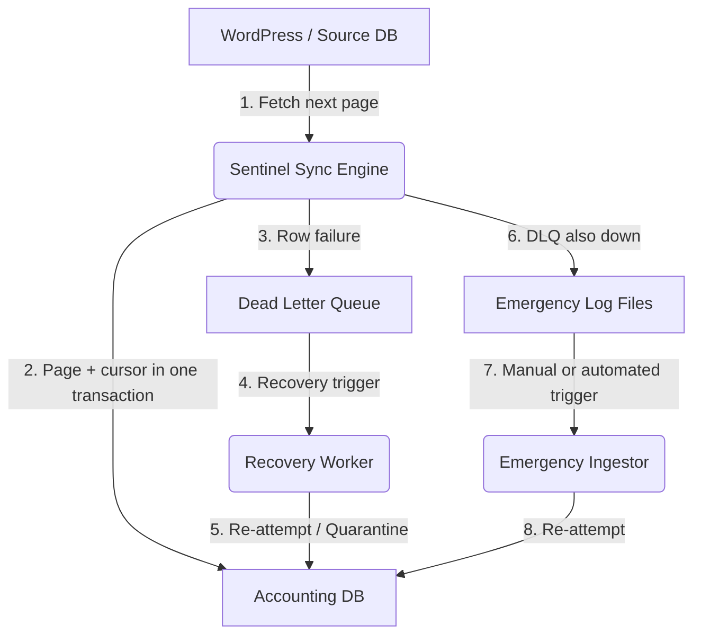

# Sentinel Sync Engine
**A Fault-Tolerant, Idempotent Data Pipeline for Mission-Critical Systems**

[](https://github.com/Hawsome)
[](https://opensource.org/licenses/MIT)
[](https://github.com/Hawsome)
[](https://github.com/Hawsome/sentinel-sync-engine/actions/workflows/php-check.yml)

## The Problem
In high-stakes environments, particularly for nonprofits and mission-driven organisations, data loss is not an option. Standard synchronisation scripts often fail due to:
*   **Network Timeouts:** External API or database connectivity drops.
*   **Server Crashes:** Resource exhaustion during large data migrations.
*   **Data Duplication:** Retrying a failed sync often results in "double-counting" records.

**Sentinel is built for when things break.**

## The Solution
Sentinel is a PHP-based synchronisation engine designed with a **"Failure-First"** mentality. It moves data from a Source (CMS) to a Destination (Relational DB) under one rule: **the cursor never moves past a row until that row is in the destination or recorded somewhere a worker or a human will find it.**
1.  **No Silent Loss:** Failed rows go to a **Dead Letter Queue (DLQ)**. If the DLQ is down, they go to a local emergency log. If that fails too, the batch rolls back and the cursor holds. Invalid rows are quarantined for review, not logged and forgotten.
2.  **Inserts, Edits and Refunds:** The cursor follows each row's `updated_at`, so a refund or a corrected amount syncs the same way a new donation does.
3.  **Idempotency & State Tracking:** A persistent `sync_cursor` table commits in the same transaction as each batch of rows. A unique constraint on `remote_id` makes every retry safe, and a version check stops a late replay from overwriting newer data.
4.  **Self-Healing:** A **Recovery Worker** replays the DLQ. Rows that keep failing are quarantined after 5 attempts; an outage does not count as an attempt.
5.  **Concurrency Safety:** `flock` stops overlapping cron jobs on one host. A `FOR UPDATE` lock on the cursor row serialises engines across hosts.

## Architecture Flow


## Three-Tier Resilience Model

| Tier | Trigger | Mechanism |
|------|---------|-----------|
| **1 - Primary Sync** | Normal operation | Keyset-paginate the source, upsert each 500-row page and advance the cursor in one transaction |
| **2 - Dead Letter Queue** | Row-level failure or invalid data | Serialise the row as JSON into `sync_dead_letter_queue` on the source DB |
| **3 - Emergency Log** | The DLQ insert also fails | Append the payload to a local JSON log file for later ingestion |

A **transient** failure (deadlock, lost connection) is not a row failure. The engine rolls back the page, holds the cursor and exits non-zero, so the next run retries cleanly instead of flooding the DLQ.

## Key Engineering Features
*   **Financial Precision:** Currency stays as integer kobo until the final write. `kobo_to_naira()` builds the `DECIMAL(10,2)` value with integer arithmetic, so no float ever touches an amount.
*   **Bounded Memory:** `pdo_mysql` buffers whole result sets by default, so an unbounded `SELECT` loads every row into PHP. Sentinel reads 500-row pages with keyset pagination on `(updated_at, id)`, which also stays fast on deep pages where `OFFSET` would not.
*   **Commit-Lag Safety:** A row is stamped when its statement runs but becomes visible when its transaction commits, so a slow transaction can land a row behind the cursor. Sentinel only reads rows older than `SYNC_LAG_SECONDS` (default 60), measured on the source server's clock.
*   **Failure Classification:** Deadlocks and dropped connections abort the page; constraint and data errors go to the DLQ. Treating a deadlock as a row error would silently lose the rows MySQL rolled back with it.
*   **Data Validation:** Every row is validated (positive integer amount within column range, RFC 5321 email format, known status) before any database write.
*   **Security:** PDO prepared statements eliminate SQL injection. Explicit column selects prevent future source-schema columns from leaking into the destination or DLQ payloads. Credentials are required via `.env`, with no hardcoded fallback values.
*   **Audit Trail:** Every sync run, including aborted ones, writes a row to `sync_audit_log` with its status, row counts, duration, final cursor and error.
*   **Honest Exit Codes:** `0` for a clean run, `1` for any failure, so cron wrappers and monitors see what happened.
*   **Tested Against Real Failures:** PHPUnit integration tests run against MySQL in CI and use triggers to force deadlocks, rejections and DLQ outages. See [docs/testing.md](docs/testing.md).

## Technical Decisions
*   **Why a `sync_cursor` table instead of `MAX(remote_id)`?** A cursor stored explicitly in the destination advances past rows that went to the DLQ. `MAX(remote_id)` cannot tell "synced" from "parked for recovery", and committing the cursor with each page makes progress crash-safe.
*   **Why `(updated_at, id)` and not just `updated_at`?** One statement can stamp a thousand rows with the same microsecond. A timestamp-only cursor either loops on that tie or skips past it; the `id` makes every position unique.
*   **Why mark refunds instead of deleting rows?** A deleted row leaves nothing for a cursor to find. A status change bumps `updated_at` and syncs like any other edit, and accounting wants the history anyway.
*   **Why store `source_updated_at` in the destination?** It lets the upsert ignore anything older than what it already has. Without it, a dead letter replayed an hour late would undo a refund.
*   **Why JSON for the DLQ?** Storing failed payloads as JSON decouples the recovery process from the source schema. If the source table changes, the Recovery Worker still has the original data snapshot as it existed at the time of failure.
*   **Why `flock` instead of `file_exists` + `file_put_contents`?** The `file_exists` check followed by a write is a classic TOCTOU race condition: two processes can both pass the check before either writes. `flock(LOCK_EX | LOCK_NB)` is atomic and the OS releases the lock automatically if the process dies. The lock file is never deleted, because unlinking it reopens the same race through a different door.
*   **Why does an outage not count as a recovery attempt?** Records are quarantined after `MAX_ATTEMPTS` (5) row-level failures. If outages counted, five recovery runs while the destination was down would quarantine every healthy record in the queue.
*   **Why write dead letters before the commit?** If the commit fails after parking, the page is retried and the rows are parked twice, which the upsert makes harmless. Committing first would let a crash advance the cursor past a row recorded nowhere.
*   **Why PHP/PDO?** PDO (PHP Data Objects) keeps the database layer portable. The SQL is MySQL-flavoured (`ON DUPLICATE KEY UPDATE`), so a PostgreSQL port would mean rewriting the upserts as `ON CONFLICT`.

## Known Limitations
*   **Hard deletes don't sync.** Refunds and cancellations must be status changes.
*   **The lag window is a bound, not a proof.** A source transaction that runs longer than `SYNC_LAG_SECONDS` can still commit a row behind the cursor.
*   **`TIMESTAMP` ends in 2038.** `updated_at` will need to move to `DATETIME(6)` before then.

Details and possible fixes are in [docs/architecture.md](docs/architecture.md#known-limitations).

## Getting Started

### Prerequisites
*   PHP >= 8.2 with `pdo_mysql`
*   MySQL (two databases: source and destination)
*   Composer

### 1. Database Setup
Run the SQL scripts provided in the `/sql` directory:
```bash
mysql -u your_db_user -p < sql/source_setup.sql
mysql -u your_db_user -p < sql/destination_setup.sql
```
Upgrading an existing install? Apply the scripts in `sql/migrations/` in order. `002_sync_updates.sql` resets the cursor, so the next sync re-reads every row once; the upsert makes that harmless.

### 2. Install Dependencies
```bash
composer install
```

### 3. Configuration
Copy the example environment file and fill in your credentials:
```bash
cp .env.example .env
```
```ini
DB_HOST=127.0.0.1
DB_PORT=3306
DB_USER=your_db_user
DB_PASS=your_db_password
DB_SOURCE=wp_source_db
DB_DEST=accounting_dest_db
```
`DB_HOST`, `DB_USER`, `DB_PASS`, `DB_SOURCE` and `DB_DEST` are required; the engine throws a clear error at startup if any are missing. `DB_PORT` defaults to `3306`. Set `DB_SOURCE_HOST` and `DB_DEST_HOST` to put the databases on separate servers; both default to `DB_HOST`. `SYNC_LAG_SECONDS` (default `60`) must exceed the longest write transaction on the source.

### 4. Execution
Run the primary sync engine:
```bash
php src/SyncEngine.php
```
Run the recovery worker to drain the Dead Letter Queue:
```bash
php src/RecoveryWorker.php
```
Run the emergency ingestor to process any filesystem fallback logs:
```bash
php src/EmergencyIngestor.php
```

### 5. Tests
```bash
composer test
```
```bash
composer analyse
```
Integration tests need a MySQL server; see [docs/testing.md](docs/testing.md).

### Suggested Crontab
```cron
# Run sync every 5 minutes, capture output to a log file
*/5 * * * * /usr/bin/php /path/to/src/SyncEngine.php >> /var/log/sentinel/sync.log 2>&1

# Run recovery worker every 15 minutes
*/15 * * * * /usr/bin/php /path/to/src/RecoveryWorker.php >> /var/log/sentinel/recovery.log 2>&1

# Check for emergency logs every 10 minutes
*/10 * * * * /usr/bin/php /path/to/src/EmergencyIngestor.php >> /var/log/sentinel/emergency.log 2>&1
```

## Future Roadmap
- [ ] Add **Slack/Email Notifications** for DLQ alerts and quarantine events.
- [ ] Develop a Web UI to monitor sync health, cursor position, and audit log in real time.
- [ ] Trip a circuit breaker on a high *row-level* failure rate (transient failures already abort the run).
